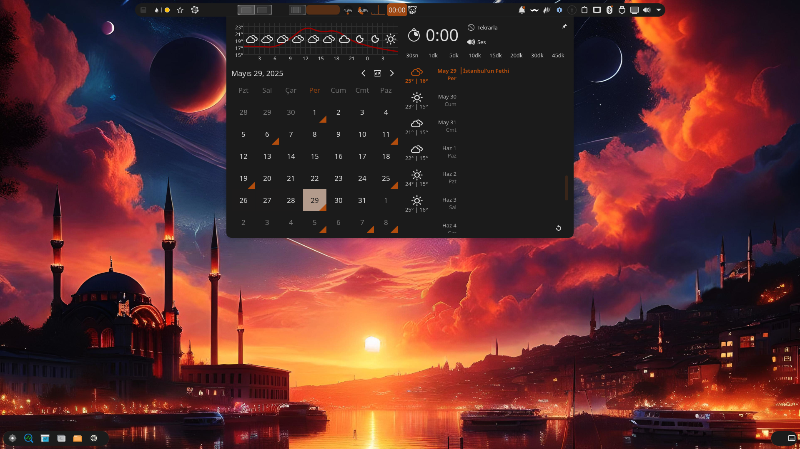

# Base ISO Builder

Pardus tabanlı özelleştirilmiş Linux dağıtımı oluşturmak için geliştirilmiş otomatik ISO yapılandırma aracı.

## 🚀 Özellikler

### Temel Özellikler
- **Pardus 23 (Yirmiüç) tabanlı** özelleştirilmiş Linux dağıtımı
- **Otomatik ISO oluşturma** sistemi
- **Çoklu kernel desteği** (stable, backports, rolling)
- **NVIDIA sürücü desteği** (proprietery drivers)
- **KDE Plasma masaüstü** ortamı
- **Türkçe yerelleştirme** desteği

### Diğer Dağıtımlardan Farkları

#### 🎯 NVIDIA Optimizasyonu
- **Otomatik NVIDIA sürücü kurulumu** ve yapılandırması
- **Nouveau sürücü devre dışı bırakma**
- **CUDA ve Vulkan desteği**
- **Hardware compatibility** iyileştirmeleri
- **GRUB parametreleri** NVIDIA için optimize edilmiş

#### 🔧 Donanım Uyumluluğu
- **Bluetooth askıya alma sorunu** otomatik düzeltme
- **USB autosuspend** devre dışı bırakma
- **ACPI uyumluluk** iyileştirmeleri
- **KWin kapatma sorunu** için özel servis

#### 🎵 Ses Sistemi
- **PipeWire** varsayılan ses sistemi
- **PulseAudio** yerine modern ses altyapısı
- **Bluetooth ses** desteği optimize edilmiş

#### 📦 Özel Paket Koleksiyonu
- **Bismih özel paketleri** ve temalar
- **Pardus paketleri** tam entegrasyonu
- **Flatpak** desteği hazır kurulu
- **OnlyOffice** ofis paketi
- **Zen Browser** modern web tarayıcısı

#### 🎨 Görsel Özelleştirmeler
- **Bismih özel teması**
- **Gün batımı GRUB teması**
- **Özelleştirilmiş masaüstü** yapılandırması
- **Zsh** varsayılan shell

## 📋 Sistem Gereksinimleri

### Yapılandırma Sistemi
- **Debian tabanlı** Linux sistemi
- **Root erişimi** (sudo)
- **En az 20GB** boş disk alanı
- **8GB RAM** (önerilen)
- **İnternet bağlantısı**

### Gerekli Paketler
```bash
sudo apt install debootstrap squashfs-tools grub-pc-bin grub-efi-amd64-bin xorriso git wget curl
```

## 🛠️ Kurulum ve Kullanım

### 1. Projeyi İndirin
```bash
git clone https://github.com/bismih-org/repository.git
cd base_iso
```

### 2. Script İzinlerini Ayarlayın
```bash
chmod +x build2.sh
```

### 3. ISO Oluşturun
```bash
sudo ./build2.sh
```

### Özelleştirilmiş Yapılandırma
Script içinde `custom()` fonksiyonu kullanarak sadece belirli bileşenleri kurabilirsiniz:

```bash
# Script içinde main() yerine custom() çağırın
custom
```

## 🔧 Yapılandırma Seçenekleri

### Kernel Seçenekleri
- **stable**: Pardus stable kernel
- **backports**: Pardus backports kernel (varsayılan)
- **rolling**: Liquorix kernel (en güncel)

### Masaüstü Ortamları
- **kde**: KDE Plasma (varsayılan)
- **gnome**: GNOME
- **xfce**: XFCE
- **mate**: MATE
- **cinnamon**: Cinnamon

## 📁 Proje Yapısı

```
base_iso/
├── build2.sh           # Ana yapılandırma scripti
├── README.md           # Bu dosya
├── grub/              # GRUB yapılandırma dosyaları
├── kaynak/            # Chroot ortamı (otomatik oluşturulur)
├── isowork/           # ISO çalışma dizini (otomatik)
└── bismih-*.iso       # Oluşturulan ISO dosyası
```

## 🔄 Ana İşlem Adımları

1. **Chroot Ortamı Kurulumu** - Pardus base sistem
2. **Depo Yapılandırması** - Pardus + Bismih depoları
3. **Sistem Güncellemesi** - En güncel paketler
4. **Kernel Kurulumu** - Seçilen kernel versiyonu
5. **Yerelleştirme** - Türkçe dil desteği
6. **GRUB Kurulumu** - Bootloader yapılandırması
7. **Firmware Kurulumu** - Donanım sürücüleri
8. **NVIDIA Sürücüleri** - Grafik kartı desteği
9. **PipeWire Kurulumu** - Modern ses sistemi
10. **Masaüstü Kurulumu** - KDE Plasma
11. **Pardus Paketleri** - Sistem araçları
12. **Ek Paketler** - Kullanıcı uygulamaları
13. **Flatpak Kurulumu** - Uygulama mağazası
14. **Sistem Optimizasyonu** - Performans iyileştirmeleri
15. **ISO Oluşturma** - Son ISO dosyası

## 🎛️ Özel Servisler

### KWin Kapatma Servisi
KDE Plasma'da yaşanan geç kapatma sorununu çözen özel servis.

### NVIDIA Uyumluluk
Nouveau sürücü devre dışı bırakma ve NVIDIA modeset parametreleri.

### Bluetooth Düzeltmesi
USB autosuspend devre dışı bırakarak Bluetooth bağlantı sorunlarını çözer.

## 📚 İçerilen Uygulamalar

### Ofis ve Verimlilik
- OnlyOffice Desktop Editors
- LibreOffice (opsiyonel)
- Thunderbird (Türkçe)

### Multimedya
- VLC Media Player
- Audacious Music Player
- EasyEffects (Flatpak)

### Sistem Araçları
- System Monitoring Center
- Timeshift (sistem yedeği)
- Pardus Update
- Pardus Software Center

### Geliştirme
- Git
- Python3 + pip
- Zen Browser

## 🐛 Bilinen Sorunlar

- ISO oluşturma süreci uzun sürebilir (1-3 saat)
- Yüksek disk alanı gereksinimi
- NVIDIA sürücü kurulumu internet bağlantısı gerektirir

## 📝 Yapılacaklar
- [ ] Duvar kağıdı özelleştirmeleri
- [ ] Daha fazla masaüstü ortamı desteği
- [ ] Minimal ISO seçeneği
- [ ] Otomatik testler

## 🤝 Katkıda Bulunma

1. Projeyi fork edin
2. Özellik branch'i oluşturun (`git checkout -b yeni-ozellik`)
3. Değişikliklerinizi commit edin (`git commit -am 'Yeni özellik eklendi'`)
4. Branch'inizi push edin (`git push origin yeni-ozellik`)
5. Pull Request oluşturun

## 📄 Lisans

Bu proje MIT lisansı altında dağıtılmaktadır.

## Teşekkürler

- Pardus ekibine temel sistem için
- NVIDIA'ya sürücü desteği için
- KDE topluluğuna masaüstü ortamı için

---

**Not**: Bu ISO, özellikle NVIDIA grafik kartlı sistemler için optimize edilmiştir. Diğer grafik kartları için de çalışır ancak en iyi performans NVIDIA sistemlerde görülür.